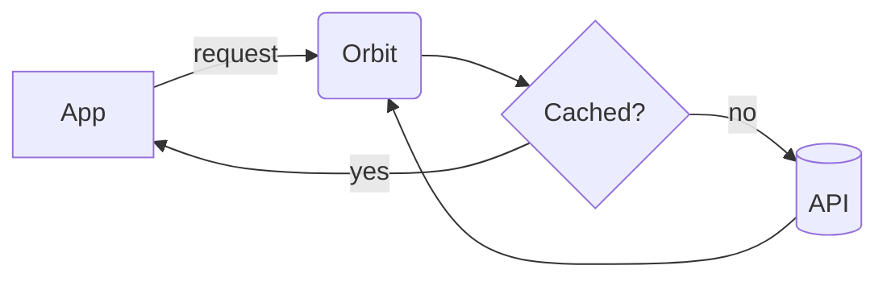

# Orbit 🚀

  

A tiny, **coroutine-first** HTTP client for Kotlin — 48 KB, no reflection.

> [!NOTE]
> Orbit is a sample project for the MarkDev – Markdown Editor screenshots.

## Install

```kotlin
dependencies {
    implementation("dev.orbit:orbit:2.0.0")
}
```

## Quick start

```kotlin
val orbit = Orbit("https://api.example.com")

suspend fun loadUser(id: Int): User =
    orbit.get("/users/$id").body<User>()
```

## How a request flows



## Roadmap

- [x] HTTP/2 and retries
- [x] Offline cache
- [ ] WebSockets
